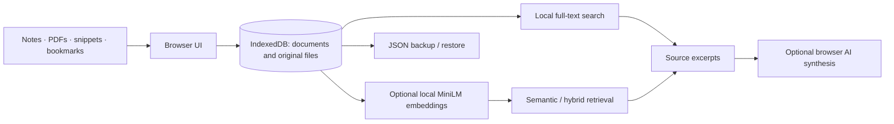

<p align="center"></p>

# B-Ram
### A little more headspace.

A local-first personal knowledge workspace for **notes, PDFs, bookmarks, and code snippets**. Capture what matters, search your own library, follow connections between ideas, and revisit what you want to remember.

Built by [Ankit Kalluraya](https://github.com/kallurayaankit).

**No account required. No remote document database. Core features work without an AI model.**

## Live demo

**[Open B-Ram →](https://b-ram.vercel.app/)**

No sign-up needed. Click **Explore with a few example notes** to try the library, then search for `repetition` or ask **“What do my notes say about spaced repetition?”** in Ask B-Ram.

The demo stores its library in your own browser, not a shared server database. Example-note loading, full-text search, source-excerpt answers, and persistence after reload were checked on 14 November 2026. Optional semantic indexing and browser AI have the compatibility and download requirements described below.

## What it does

| Feature | How it works |
| --- | --- |
| Capture and organize | Create notes, snippets, and bookmarks; add tags and filter your library by type or tag. |
| Import files | Extract text from PDFs, Markdown, plain text, and supported code files, while keeping the original file locally. |
| Full-text search | BM25-style term weighting with title and tag boosts, entirely in the browser. |
| Semantic and hybrid search | Optional MiniLM embeddings run locally through ONNX Runtime Web / WebAssembly. Hybrid search combines lexical and semantic rankings. |
| Ask B-Ram | Retrieve relevant source excerpts without generative AI. On compatible devices, optionally enable browser AI for a synthesized answer with source references. |
| Connections | Explore explicit `[[Note title]]` links, shared tags, and semantic similarity between recent items. |
| Daily review | Revisit saved items with a simple spaced-review schedule. |
| Backup and restore | Export your library as JSON and restore missing items without overwriting existing ones. |
| Offline app shell | A service worker caches the interface. Installation is offered where the browser supports it. |

## Try it locally

This repository contains the browser edition as static files. There is no package installation or build step required to serve it.

With Git and Python 3 installed:

```sh
git clone https://github.com/kallurayaankit/b-ram.git
cd b-ram
python3 -m http.server 8000 --bind 127.0.0.1
```

Open **http://localhost:8000** in a modern browser. On Windows, use `py -m http.server 8000 --bind 127.0.0.1` if `python3` is unavailable.

Serve over HTTP on localhost or HTTPS rather than opening `index.html` directly: JavaScript modules, service workers, and browser APIs need an appropriate origin. For hosting, serve the repository root as a static site; `vercel.json` already describes a no-build deployment.

### A two-minute walkthrough

1. Choose **Explore with a few example notes**, or capture your first note.
2. Add a shared tag to two notes and write `[[Another note title]]` in one of them.
3. Search with **Full-text search**, then open **Connections**.
4. Ask a specific question in **Ask B-Ram** and inspect the returned source excerpts.
5. Export a backup from **Settings & backup**.

For semantic search, choose **Build index** in Settings and accept the model download. Rebuild after adding or editing items. **Enable Browser AI** is separate and optional; it requires the browser's experimental `LanguageModel` Prompt API and compatible hardware.

## How it fits together



- [`index.html`](./index.html), [`app.js`](./app.js): interface and interactions.
- [`web-entry.js`](./web-entry.js): activates the browser edition, replaces legacy interface copy, and adds installation and connections views.
- [`local-store.js`](./local-store.js): IndexedDB storage, import, retrieval, review scheduling, connections, backups, and browser AI integration.
- [`embeddings.js`](./embeddings.js): bundled tokenizer and ONNX runtime integration for quantized `Xenova/all-MiniLM-L6-v2`.
- [`vendor/`](./vendor/): local PDF.js and runtime assets.
- [`sw.js`](./sw.js): same-origin app-shell caching.

**Implementation note:** some base HTML still contains older SQLite/Ollama wording. The active entry point replaces it at runtime. This browser edition uses **IndexedDB**, not a SQLite server, and does not require Ollama or an API key.

## Privacy, with the important details

- Documents, original attachments, and stored vectors live in **IndexedDB for this site origin and browser profile**. There is no automatic cross-device sync.
- The browser edition routes document operations to local storage rather than a document API. It does not include application analytics.
- “Local-first” does **not** mean “never uses the network.” The host receives normal page requests and IP addresses. Optional semantic search downloads model files from Hugging Face on first use; runtime assets also need to be available.
- Browser AI is experimental. Review your browser's processing information before enabling it; availability and model downloads are controlled by the browser.
- Local storage is not an encrypted vault. JSON backups contain readable content and encoded original attachments. Keep them somewhere private.
- Clearing site data, changing browsers/origins, or losing the device can make a library unavailable. **Export backups regularly.** Requesting persistent storage is not a replacement for backups.

## Current limits

- Imports are limited to 20 MiB per file; PDFs to 500 pages; text content to one million characters. PDFs need extractable text: **OCR is not included**.
- Supported text/code imports: `.txt`, `.md`, `.py`, `.js`, `.ts`, `.json`, `.css`, `.html`, `.rs`, `.go`, and `.sql`.
- Bookmarks save the URL and text you supply. They do not automatically fetch or archive the linked webpage.
- Connections show up to 60 recently updated items. Search results are capped at 100; answers retrieve up to five documents.
- Backups restore missing document IDs and skip existing ones. Embeddings are not exported; rebuild the index after restoring. Backup imports are limited to 100 MiB.
- Offline operation depends on assets having been cached. First-time model downloads require a connection; browser caching and storage limits vary.
- Generated answers can be wrong. Source excerpts are available without generation; always check the underlying notes.
- This repository does not establish production-scale performance benchmarks or an independent security audit.

## Third-party notices

Bundled dependencies retain their own notices, including [TOKENIZERS-LICENSE](./TOKENIZERS-LICENSE), [embeddings.js.LEGAL.txt](./embeddings.js.LEGAL.txt), and files under [vendor](./vendor/). Review these before redistributing bundled code.

---

[GitHub](https://github.com/kallurayaankit) · [Portfolio](https://kallurayaankit.github.io/) · [X](https://x.com/uhnkitcalorieya)
